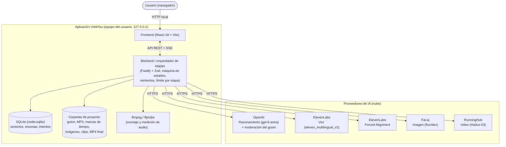
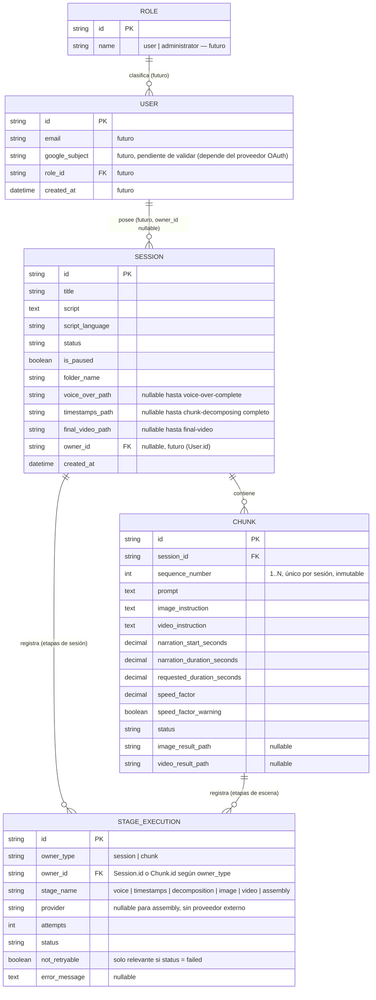
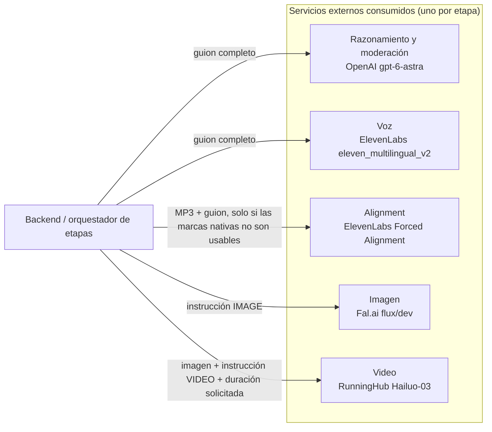

## Índice

0. [Ficha del proyecto](#0-ficha-del-proyecto)
1. [Descripción general del producto](#1-descripción-general-del-producto)
2. [Arquitectura del sistema](#2-arquitectura-del-sistema)
3. [Modelo de datos](#3-modelo-de-datos)
4. [Especificación de la API](#4-especificación-de-la-api)
5. [Historias de usuario](#5-historias-de-usuario)
6. [Tickets de trabajo](#6-tickets-de-trabajo)
7. [Pull requests](#7-pull-requests)

---

## 0. Ficha del proyecto

### **0.1. Tu nombre completo:**

Jose Antonio Munoz Elguezabal

### **0.2. Nombre del proyecto:**

Vid4You

### **0.3. Descripción breve del proyecto:**

El sistema es una plataforma de generación de contenido End to End, la imagen y el video de cada chunk pueden ser entregables independientes, mientras procesa cada imagen y cada video se pueden descargar por partes, finalmente el video editado final contiene todos los chunks de video editados, unidos y narrados por el voice-over generado.

### **0.4. URL del proyecto:**

https://vid4you.download

Vid4You es una aplicación local (ver 2.4), por lo que todavía no hay un sitio público. El dominio aloja hoy el relé de telemetría (`otel.vid4you.download`, que responde 404 a una petición normal por diseño) y será el de las descargas de las versiones publicadas (JOS-205, JOS-206).

### 0.5. URL o archivo comprimido del repositorio

https://github.com/TonyMElguezabal/AI4Devs-finalproject


---

## 1. Descripción general del producto

Vid4You es una aplicación web que convierte un script de vídeo finalmente en un video completo pasando por una lista de escenas narradas (“chunks”) en un conjunto de imágenes y videos cortos generados por IA: una imagen y un video por cada chunk.

### **1.1. Objetivo:**

Vid4You es una aplicación web que convierte un guion de texto en un video narrado listo para publicar, en formato horizontal MP4 (16:9). El usuario solo aporta un título y un guion: el sistema genera automáticamente la narración en audio, las imágenes y los clips de cada escena, y monta el video final sincronizado con la voz. Así resuelve el problema de producir contenido narrado (por ejemplo, para YouTube) sin necesidad de grabar voz, editar video ni tener conocimientos de edición audiovisual.

### **1.2. Características y funcionalidades principales:**

- Creación de sesiones (proyectos de video) a partir de un título y un guion.
- Generación automática de un voice-over (narración en audio) completo por guion, en el idioma seleccionado por el usuario.
- Obtención de las marcas de tiempo que sitúan cada fragmento del guion dentro del audio narrado.
- División automática del guion en escenas (chunks) respetando fronteras de oración, y generación de las instrucciones visuales de imagen y video de cada escena.
- Generación de una imagen y un clip de video por escena, sincronizados con su fragmento narrado.
- Montaje del video final: sincronización de los clips con el audio completo y ensamblado en un único MP4 horizontal.
- Visualización en tiempo real del progreso por fase y por escena, incluyendo resultados disponibles y errores.
- Pausa de la generación antes del lanzamiento de una fase, y continuación explícita por parte del usuario.
- Descarga parcial de resultados (imágenes y clips de escenas individuales) durante el procesamiento, y descarga del video final al completarse.
- Reintentos automáticos (hasta 3 por etapa) y reintento manual ante fallos.
- Corrección del prompt visual (imagen o video) de una escena que haya fallado, sin alterar el guion ni el orden narrativo.
- Persistencia de sesiones, estados y resultados, incluso tras reinicios del sistema: el trabajo en curso se retoma solo al volver a arrancar.
- Ajuste manual de la pausa que sigue a una escena y reconstrucción del video final, que conserva las versiones anteriores.
- Aplicación local para macOS y Windows (un ejecutable que abre el navegador), con telemetría opcional y desactivada por defecto.

### **1.3. Diseño y experiencia de usuario:**

La interfaz es una aplicación web de una sola página (React) que se abre en el navegador, en `http://localhost:5173` en desarrollo y en `http://127.0.0.1:3100` en la aplicación empaquetada. El flujo de usuario es:

1. **Alta de sesión**: el usuario escribe un título, pega el guion y elige el idioma (inglés o español). Antes de crear la sesión, el guion pasa una comprobación de contenido (moderación de OpenAI); si no pasa, se rechaza y el formulario conserva el texto para editarlo.
2. **Página de sesión**: muestra el título, el guion, el estado de la sesión y el avance por fase (voz, descomposición, escenas, montaje) y por escena, con su proveedor, número de intentos, errores legibles y resultados disponibles. Se actualiza en vivo sin recargar (Server-Sent Events, ADR 0003).
3. **Acciones disponibles**: pausar y continuar toda la sesión, reintentar la fase o escena que falló, corregir solo la instrucción `IMAGE` o `VIDEO` de una escena fallida, descargar la imagen o el clip de una escena durante el proceso, ajustar la pausa que sigue a una escena y reconstruir el video final, y descargar el MP4 final.
4. **Privacidad**: en el primer arranque se pregunta, con tres casillas desmarcadas, si se activan los informes de errores, el conteo de uso de proveedores y el conteo de uso anónimo. Todo está desactivado por defecto (`PRIVACY.md`).

Las capturas de pantalla no están incluidas en este fichero; los informes de verificación en navegador de cada cambio (con capturas) están en `openspec/changes/archive/*/reports/`.

### **1.4. Instrucciones de instalación:**

**Requisitos previos**

- Node.js **24 o superior** (el backend ejecuta TypeScript de forma nativa y usa `node:sqlite`; CI usa Node 24).
- `ffmpeg` y `ffprobe` accesibles. El backend los busca, por este orden, en las variables `FFMPEG_PATH` / `FFPROBE_PATH`, en `/opt/homebrew/bin` y en el `PATH`. En macOS: `brew install ffmpeg`; en Windows o Linux, instalarlos y añadirlos al `PATH`.
- Claves de API de los cuatro proveedores (ver "Credenciales" más abajo). Sin la clave de OpenAI no se puede crear ninguna sesión, porque la comprobación de contenido del guion la necesita.

**Instalación y arranque en desarrollo**

```bash
# 1. Clonar el repositorio y entrar en la rama de integración
git clone https://github.com/TonyMElguezabal/AI4Devs-finalproject.git
cd AI4Devs-finalproject
git checkout main

# 2. Backend (API en http://127.0.0.1:3100)
cd backend
npm ci
# Crear backend/.secrets.json con las credenciales (ver "Credenciales")
npm start

# 3. Frontend (otra terminal, http://localhost:5173)
cd frontend
npm ci
npm run dev
```

Abrir `http://localhost:5173`. La documentación interactiva de la API está en `http://127.0.0.1:3100/docs` (solo en desarrollo) y la comprobación de salud en `http://127.0.0.1:3100/health`.

**Credenciales**

Las claves se pueden introducir en `/admin` (sección «Providers»): se guardan cifradas en la base de datos local, no se vuelven a mostrar (solo su estado y los cuatro últimos caracteres) y la aplicación las pide por el rol de la etapa, no por el nombre del proveedor. Las variables de abajo siguen valiendo como respaldo para los cinco proveedores creados a partir de los ajustes, hasta que se guarda una clave para ellos; una clave guardada gana. La clave maestra del cifrado es un fichero aparte (`PROVIDER_KEY_PATH`, por defecto `data/provider-keys.key`, modo 0600): protege la base de datos copiada por sí sola, no a quien pueda leer ambos ficheros.

Se leen primero del entorno y después del fichero `.secrets.json` (nunca van en el repositorio, que ya lo ignora). Los nombres son:

```json
{
  "OPENAI_KEY": "…",
  "FAL_API_KEY": "…",
  "RUNNINGHUB_API_KEY": "…",
  "ELEVENLABS_KEY": "…"
}
```

- En desarrollo el fichero es `backend/.secrets.json`.
- En la aplicación empaquetada es `.secrets.json` dentro de la carpeta de datos del usuario (ver más abajo).
- En Windows, comprobar que el fichero se llama exactamente `.secrets.json` (el Bloc de notas puede guardarlo como `.secrets.json.txt`) y que está en UTF-8 sin BOM; en caso contrario las claves no se leen y la creación de sesiones falla con el mensaje "The content check is temporarily unavailable".

**Variables de entorno**

| Variable | Valor por defecto | Para qué sirve |
|---|---|---|
| `PORT` | `3100` | Puerto del backend (solo escucha en `127.0.0.1`). |
| `DB_PATH` | `data/skeleton.sqlite` | Fichero SQLite (relativo a `backend/`). |
| `PROJECTS_ROOT` | `data/projects` | Carpeta donde se guardan las carpetas de proyecto (guion, MP3, imágenes, clips, MP4). |
| `FFMPEG_PATH`, `FFPROBE_PATH` | resolución automática | Ruta a `ffmpeg` y `ffprobe`. |
| `CORS_ALLOWED_ORIGINS` | vacío | Orígenes adicionales permitidos (lista separada por comas). Por defecto solo el servidor Vite y el propio backend. |
| `STAGE_CONCURRENCY_LIMIT` | límites de `config/providers.ts` | Sustituye el límite de peticiones simultáneas de la etapa de imagen (solo pruebas manuales). |
| `RETRY_BASE_DELAY_SECONDS`, `RETRY_CAP_DELAY_SECONDS` | 2 y 30 | Acortan la espera entre reintentos para pruebas manuales. |
| `BODY_LIMIT_BYTES` | 50 MiB | Tamaño máximo del cuerpo de una petición. |
| `ALLOW_TEST_ENDPOINTS`, `USE_STUB_VOICE_PROVIDER`, `USE_STUB_VIDEO_PROVIDER`, `VOICE_STUB_DELAY_MS` | desactivadas | Solo para pruebas: activan endpoints de prueba y proveedores simulados. La aplicación empaquetada las ignora. |

**Datos y reinicio**

Todo se guarda en local: la base de datos SQLite y las carpetas de proyecto (en desarrollo, bajo `backend/data/`, ignorado por Git). Para empezar de cero basta con parar el backend y borrar esa carpeta. Los registros están en `data/logs/` junto a la base de datos.

**Aplicación empaquetada (macOS y Windows)**

Vid4You se distribuye como un ejecutable por plataforma que sirve el frontend y la API en `http://127.0.0.1:3100`, abre el navegador y guarda sus datos en la carpeta del usuario: `~/Library/Application Support/Vid4You` en macOS y `%APPDATA%\Vid4You` en Windows (ADR 0007). Un segundo arranque abre la instancia que ya está en marcha. Va junto a `ffmpeg` y `ffprobe`. El ejecutable de Windows se ha ejecutado una vez con éxito en un portátil Windows, de principio a fin con proveedores reales (`openspec/changes/archive/2026-10-19-define-production-deployment/reports/2026-10-20-step-6e-windows-run.md`). Hoy no está firmado: Windows SmartScreen o macOS Gatekeeper pedirán confirmación la primera vez. Ver "Limitaciones conocidas" en la sección 2.4 para el estado del proceso de construcción.

### **1.5. Solución de problemas y recuperación**

| Síntoma | Causa probable | Qué hacer |
|---|---|---|
| "The content check is temporarily unavailable. Submit the script again in a moment." al crear una sesión | Falta `OPENAI_KEY`, el fichero de claves no se puede leer (nombre o BOM en Windows), no hay red hacia `api.openai.com` o OpenAI respondió con error | Revisar el fichero de claves (ver arriba), la conexión y reintentar. El mensaje no distingue la causa. |
| El navegador no abre la página en el ejecutable | Puerto 3100 ocupado por otro programa | Cerrar el otro programa o abrir `http://127.0.0.1:3100` a mano. |
| Una fase queda en `failed` | Se agotaron los 3 reintentos automáticos o el fallo no es reintentable | Pulsar el reintento manual de esa fase o escena (abre un ciclo nuevo de hasta 3 reintentos). Lo ya generado se conserva. |
| La sesión no avanza y está pausada | Hay una pausa de sesión | Pulsar "Continuar". Una pausa no cancela las peticiones ya enviadas. |
| Se cerró la aplicación a mitad de una generación | — | Volver a abrirla: las sesiones, el progreso y las peticiones en vuelo se recuperan solos (`openspec/specs/restart-recovery/spec.md`). Una petición a un proveedor se espera o se registra como intento fallido y sigue la política de reintentos. |
| El video final tiene una pausa demasiado larga o corta | Pausa original tras una escena | Ajustar la pausa de esa escena y reconstruir el video final; los intentos anteriores se conservan como versiones. |

**Copia de seguridad y vuelta atrás.** Los datos de usuario están en la carpeta de datos (SQLite y proyectos); copiarla entera con la aplicación cerrada es una copia de seguridad completa. Para volver a una versión anterior, cerrar la aplicación, restaurar la copia de la carpeta de datos y volver a instalar el ejecutable o la rama anterior. No se ha verificado que una versión antigua del programa pueda abrir una base de datos migrada por una versión más nueva; por eso la copia previa a cada actualización es necesaria.

### **1.6. Limitaciones conocidas**

Estado del MVP a 20-oct-2026. Ninguna impide generar un video; todas están registradas para tratarlas después.

| Limitación | Efecto | Seguimiento |
|---|---|---|
| Un clip cuyo intento agota el tiempo se vuelve a pedir al proveedor, y la tarea anterior sigue en marcha y se factura. | Una escena puede costar varias tareas de video (el 14-oct-2026, los clips de 14 s agotaron el tiempo en 8 de 8 intentos). Una sesión corta con clips de 6 s y 11 s sí terminó. | JOS-204 |
| Los tiempos máximos por fase (voz y razonamiento 600 s, video 1200 s) son provisionales: solo se midió una sesión de 2 escenas con la compilación actual. | Una sesión de tamaño real (1.500–1.800 palabras, 30–50 clips) puede agotar el tiempo. | JOS-209 |
| Los límites reales de peticiones por etapa de RunningHub y ElevenLabs, y los casos límite de la división por cláusulas (§6.1), no están verificados. | El límite de peticiones simultáneas usa los valores de `config/providers.ts`, sin contrastar con los límites reales. | JOS-188, JOS-189 (posteriores al MVP) |
| La comprobación del guion muestra un único mensaje genérico para cuatro causas distintas (falta `OPENAI_KEY`, fichero de claves ilegible, sin red hacia OpenAI, error de OpenAI). | El usuario debe revisar la tabla de la sección 1.5 para descubrir cuál es. | Aplazada por el propietario del producto |
| El ejecutable no está firmado. | Windows (SmartScreen) y macOS (Gatekeeper) muestran una advertencia al abrirlo. | JOS-207 |
| El ejecutable se construye con scripts de prueba de concepto y no hay flujo de publicación (ver 2.4). | No hay versiones publicadas ni actualización automática. | JOS-205, JOS-206 |
| No se ha verificado que una versión anterior abra una base de datos migrada por una posterior. | Volver a una versión anterior exige restaurar la copia de la carpeta de datos (ver arriba). | JOS-210 |
| Las pruebas de contrato con proveedores reales no se ejecutan en CI (ver 2.6). | Un cambio en la API de un proveedor solo se detecta en una ejecución real. | — |
| Algunas revisiones humanas de los cambios archivados (por ejemplo, la 17.7 de `define-provider-configuration`) se aceptaron como excepción y no se realizaron. | Esos cambios tienen evidencia de pruebas automáticas pero no revisión humana. | JOS-203, M7 |

---

## 2. Arquitectura del Sistema

### **2.1. Diagrama de arquitectura:**

El stack está decidido y documentado en los ADR de `docs/adr/`: backend en TypeScript sobre Node.js con Fastify y Zod (ADR 0001), persistencia en SQLite embebido mediante `node:sqlite` (ADR 0002), actualizaciones en vivo con Server-Sent Events (ADR 0003), frontend en React 18 con Vite (ADR 0004), montaje de video con ffmpeg (ADR 0005) y distribución como aplicación local empaquetada (ADR 0007).



**Patrón.** Arquitectura cliente-servidor en capas, con el backend actuando como orquestador de un pipeline de etapas con estado (una máquina de estados por sesión y por escena). Se elige por los propios requisitos del PRD: cada etapa tiene su propio presupuesto de reintentos y su límite de concurrencia compartido entre sesiones, y el sistema debe sobrevivir a reinicios sin perder trabajo ni enviar dos veces una petición.

**Beneficios.** Separación clara de responsabilidades (interfaz / orquestación y reglas de negocio / persistencia y archivos / proveedores externos); encaja con la máquina de estados de sesión y escena del PRD (§8); es simple de operar en un único equipo, sin cola de mensajes ni servidor de base de datos.

**Sacrificios.** Un solo proceso concentra la API y la orquestación (no hay workers ni colas independientes); está pensado para un único usuario local, no para multiusuario ni alta concurrencia.

**Evolución si creciera el uso** (orientativa, sin compromiso): separar el orquestador del servidor de API en workers o colas de trabajo, y cambiar SQLite por un servidor de base de datos.

### **2.2. Descripción de componentes principales:**

| Componente | Responsabilidad | Ubicación |
|---|---|---|
| Frontend (React 18 + TypeScript + Vite) | Alta de sesión, progreso por fase y por escena en vivo (`EventSource`), pausa y continuación, reintentos y corrección de instrucciones, descargas parciales y del video final, diálogo de privacidad. | `frontend/` |
| Backend / orquestador (Fastify + Zod) | Expone la API REST y el flujo SSE; aplica la máquina de estados, la política de reintentos (1 intento + 3 automáticos por ciclo), el límite de peticiones simultáneas por etapa, la pausa de sesión y la recuperación tras reinicios; llama a los proveedores. | `backend/src/` |
| Persistencia (SQLite) | Sesiones (`runs`), escenas, intentos de etapa, resultados, marcas de tiempo, ediciones de pausa, versiones del video final y ajustes de telemetría. Las migraciones se registran en `schema_migrations`. | `backend/src/db.ts` |
| Carpetas de proyecto | Guion, voice-over (MP3), marcas de tiempo, imágenes, clips y MP4 final por proyecto; nunca se sobrescriben ni caducan. | `PROJECTS_ROOT` |
| Montaje (ffmpeg) | Ajusta la velocidad de cada clip a su intervalo, los une en orden ascendente y añade la narración como única pista de audio; salida 1920×1080 a 30 fps, H.264. | `backend/src/ffmpegAssemblyTool.ts` |
| Proveedores de IA (externos) | Perfiles de proveedor por etapa, gestionados en `/admin` (añadir, editar, borrar, parámetros y clave); el primero de cada etapa nace de los ajustes (`backend/config/settings.default.json`); claves cifradas en la base de datos, con el entorno o `.secrets.json` como respaldo. | PRD §11, §11.2 |
| Telemetría (opcional) | Informes de errores y conteos, solo si el usuario los activa; se envían por HTTPS a un relé del proyecto. | `backend/src/telemetry/`, `infra/telemetry-relay/` |

### **2.3. Descripción de alto nivel del proyecto y estructura de ficheros**

```
AI4Devs-finalproject/
├── backend/          # API Fastify, orquestador, proveedores, SQLite, pruebas (vitest)
│   ├── src/          #   código (TypeScript sin compilar, ejecutado por Node)
│   ├── src/config/   #   proveedores, límites, credenciales, ffmpeg
│   ├── src/retry/    #   política de reintentos, planificador, límite de tiempo por intento
│   ├── src/telemetry/#   telemetría opt-in y aviso de nueva versión
│   └── test/         #   pruebas unitarias y de integración
├── frontend/         # SPA React + Vite y sus pruebas
├── docs/             # PRD (y versiones anteriores), ADR, spec de API, modelo de datos, estándares
├── openspec/         # Specs vigentes (specs/) y cambios archivados con sus informes (changes/archive/)
├── infra/            # Relé de telemetría y paneles de Grafana
├── packages/specboot # Utilidad de arranque de OpenSpec
├── ai-specs/         # Skills y agentes reutilizables (fuente canónica)
├── .github/workflows # CI (typecheck, lint y pruebas) y despliegue del relé de telemetría
├── PRIVACY.md        # Política de privacidad de la telemetría
└── readme.md
```

Los ficheros `AGENTS.md`, `CLAUDE.md`, `GEMINI.md` y `codex.md` apuntan a los estándares del proyecto para las distintas herramientas de IA.

### **2.4. Infraestructura y despliegue**

- **Dónde se ejecuta**: en el equipo del usuario, escuchando solo en `127.0.0.1`; llama a los proveedores de IA en la nube. No hay servidor central ni cuentas (ADR 0007).
- **Entorno**: `main` es el entorno oficial (decisión del propietario del producto, 20-oct-2026; ADR 0007 enmendado). La rama `feature/entrega-2-JAME` fue la rama de integración del MVP y se promovió a `main` mediante la PR #71. Mientras no exista un flujo de publicación (JOS-205, JOS-206) no se publica nada automáticamente.
- **Integración continua**: `.github/workflows/ci.yml` ejecuta, en cada PR hacia `feature/entrega-2-JAME` o `main` y en cada push a `main` o a la rama de integración, el chequeo de tipos y las pruebas de backend (con ffmpeg instalado) y de frontend, sobre Node 24. Las pruebas nunca usan una base de datos ni un proveedor reales.
- **Telemetría**: un relé (`infra/telemetry-relay/`, despliegue en `.github/workflows/telemetry-relay.yml`) recibe los datos opt-in, los filtra y los reenvía a Grafana Cloud.

**Limitaciones conocidas del despliegue** (la lista completa está en la sección 1.6)

- El ejecutable empaquetado se construyó con scripts de prueba de concepto archivados (`openspec/changes/archive/2026-10-19-define-production-deployment/poc/local/`), no con un proceso integrado en el repositorio. El flujo de publicación automática (construir todas las plataformas por árbol de código, publicar como pre-release en UAT y promover los mismos ficheros en `main`) está descrito en ese mismo directorio (`poc/workflows/release.yml`) como boceto y **no está activado** en `.github/workflows/`.
- El ejecutable no está firmado.
- Aún no se han medido tiempos con una sesión de tamaño real (1.500–1.800 palabras, 30–50 clips): los límites máximos por fase (voz y razonamiento 600 s, video 1200 s) son provisionales.

### **2.5. Seguridad**

- **Modelo de acceso**: aplicación local de un solo usuario, sin cuentas ni autenticación (PRD §12.3). El backend solo escucha en `127.0.0.1`.
- **Protección frente a páginas web externas**: cualquier sitio que visite el usuario podría enviar peticiones a `127.0.0.1`. Por eso el backend rechaza toda petición cuyo `Origin` no sea el propio de la aplicación (o el servidor Vite en desarrollo) o cuyo `Host` no sea la dirección de bucle local y el puerto (`backend/src/originPolicy.ts`), incluido el flujo SSE.
- **Secretos**: las claves de los proveedores se guardan cifradas (AES-256-GCM) desde `/admin`, con el entorno o `.secrets.json` como respaldo; el fichero está en `.gitignore`, nunca se ha confirmado en el historial de Git, y los mensajes de error nombran la credencial que falta sin mostrar su valor. En la aplicación empaquetada viven en la carpeta de datos del usuario, nunca en el ejecutable.
- **Contenido del guion**: se comprueba con el endpoint de moderación de OpenAI antes de crear la sesión; si no se puede comprobar, se rechaza (nunca se registra un guion sin comprobar).
- **Compilaciones empaquetadas**: no exponen endpoints de prueba ni proveedores simulados, ni `/docs`, sea cual sea el entorno del usuario.
- **Dependencias**: `npm audit --omit=dev` no informa vulnerabilidades en backend ni en frontend (octubre de 2026).
- **Privacidad**: la telemetría está desactivada por defecto y solo envía los datos descritos en `PRIVACY.md` (nunca guiones, narración, prompts, rutas ni claves).
- **Evolución futura** (fuera del MVP): autenticación y roles (el rol Administrador previsto en PRD §2.1 y §11.2) si algún día se expone fuera del equipo local.

### **2.6. Tests**

Comandos, desde `backend/` y `frontend/`:

```bash
npm run typecheck   # tsc --noEmit
npm run lint        # eslint (typescript-eslint, type-aware)
npm test            # vitest run
npm run build       # solo frontend: tsc --noEmit && vite build
```

- **Unitarias e integración (vitest)**: en la última validación completa (rama `chore/sync-integration-branches` en `eeda3198`, 22-oct-2026, PR #93) pasaron 2.090 pruebas de backend (5 omitidas, las de contrato con proveedores) y 312 de frontend, con chequeo de tipos y lint limpios y compilación del frontend correcta. CI ejecuta chequeo de tipos, lint y pruebas en cada PR.
- **Pruebas de contrato con proveedores reales**: existen cuatro ficheros (`backend/test/*.contract.test.ts`) que llaman a las APIs reales y solo se ejecutan con `RUN_PROVIDER_CONTRACT_TESTS=1` y claves reales; no se ejecutan en CI.
- **Pruebas manuales de endpoints con curl y E2E en navegador (Playwright)**: las ejecuta el agente por cada cambio y deja un informe en `openspec/changes/archive/<cambio>/reports/`.
- **Sesión real de extremo a extremo**: el 20-oct-2026 una sesión corta con los cuatro proveedores reales llegó a `final-video` con un intento por etapa, y el ejecutable de Windows generó un video completo (informes en `openspec/changes/archive/2026-10-19-raise-video-time-limit/reports/` y `…/define-production-deployment/reports/`).
- **Lint y análisis estático**: ESLint 9 con las reglas *type-aware* de typescript-eslint en `backend/` y `frontend/` (más las reglas de React Hooks en el frontend), sobre el código y las pruebas, y como paso de CI que hace fallar la PR (JOS-208). Una excepción se suprime en su línea con el motivo; no hay desactivaciones globales.
- **Ejecutable empaquetado (macOS arm64, 20-oct-2026)**: construido con el script de la prueba de concepto desde una copia temporal y arrancado en otro puerto con una carpeta de datos vacía: `/health` y la página responden 200, un `Origin` o `Host` ajeno recibe 403, `/docs` y los endpoints de prueba responden 404 aunque `ALLOW_TEST_ENDPOINTS=1` esté definida, y un segundo arranque detecta la instancia en marcha y sale. No se probó una sesión completa con este binario (sí en Windows, ver arriba).
- **No ejecutado**: las pruebas de contrato con proveedores reales no se ejecutan en CI ni se han ejecutado para este cierre, y el ejecutable empaquetado no tiene un script de construcción integrado (ver 1.6).

La estrategia sigue TDD y los pasos obligatorios de `docs/openspec-tasks-mandatory-steps.md`.

---

## 3. Modelo de Datos

> El motor de persistencia está decidido: SQLite embebido mediante `node:sqlite` (ADR 0002). El modelo **implementado** es el que describe `docs/data-model.md` (tablas `runs`, `scenes`, `provider_requests`, `stage_attempts`, `voice_overs`, `narration_timestamps`, `scene_results`, `scene_video_results`, `scene_pause_edits`, `final_video_builds`, `telemetry_settings` y `schema_migrations`); la tabla de equivalencias de la sección 3.0 lo relaciona con el diagrama conceptual de la Entrega 1 (3.1), que se conserva como referencia de diseño. Las entidades `User` y `Role`, y el campo `Session.owner_id`, siguen siendo diseño **a futuro**: el MVP no implementa autenticación ni cuentas (`docs/PRD.md` §2.1, §2.3, §12.3).

### **3.0. Modelo implementado (resumen)**

| Concepto del diagrama conceptual | Tabla(s) reales | Notas |
|---|---|---|
| `Session` | `runs` | Título, guion e idioma inmutables; estado derivado de los registros (no hay columna de estado de voz); marca de pausa; ruta del video final. |
| `Chunk` | `scenes` | Estados: `submitted`, `image-generating`, `image-complete`, `video-generating`, `chunk-complete`, `failed`. Guarda intervalo de narración, instrucciones `IMAGE`/`VIDEO`, duración solicitada y factor de velocidad. |
| `StageExecution` | `stage_attempts` (voz, marcas de tiempo, descomposición, montaje) y `provider_requests` (imagen y video) | Cada intento queda registrado con ciclo, secuencia dentro del ciclo, disparador (`initial`, `automatic`, `manual`), resultado y causa. La restricción única `(stageInstanceKey, cycle, sequenceInCycle)` impide pasar de 4 intentos por ciclo. |
| Resultados | `voice_overs`, `narration_timestamps`, `scene_results`, `scene_video_results` | Confirmaciones idempotentes: una repetición de éxito no duplica ni sobrescribe. |
| — (añadidas después) | `scene_pause_edits`, `final_video_builds` | Ajuste manual de pausas y versiones del video final (`final-video-2.mp4`, …). |
| — | `telemetry_settings`, `schema_migrations` | Consentimiento de telemetría y migraciones aplicadas. |

El estado de la sesión (`submitted`, `voice-over-generating`, `voice-over-complete`, `chunk-decomposing`, `chunks-processing`, `final-video-generating`, `final-video`, `failed`) se deriva de estos registros; la pausa es una marca adicional, no un estado (`docs/PRD.md` §8–§9).

### **3.1. Diagrama conceptual del modelo de datos (Entrega 1, referencia de diseño):**



**Nota de implementación sobre `STAGE_EXECUTION`.** El par `owner_type`/`owner_id` es una asociación polimórfica a nivel lógico (una etapa puede pertenecer a una `Session` o a un `Chunk`, nunca a ambas). Un motor relacional clásico no expresa esto como una única FK tipada; la implementación física habitual sería dos columnas nullable mutuamente excluyentes (`session_id`, `chunk_id`) o una tabla de enlace por tipo de dueño. Se deja como decisión de `define-persistence`.

### **3.2. Descripción de entidades principales:**

| Entidad | Propósito | Campos clave | Origen (PRD) |
|---|---|---|---|
| **Session** | Representa un proyecto de video: título, guion, idioma, progreso y resultados. | `id` PK; `title`, `script`, `script_language` (no vacíos, guion inmutable tras iniciar el proyecto); `status` (uno de los 8 estados de sesión); `is_paused` (marca independiente del estado); `folder_name` (carpeta de proyecto); `voice_over_path`, `timestamps_path`, `final_video_path`; `owner_id` FK nullable (futuro). | §3, §4.1, §4.2, §8.1, §9, §12.1, §12.2 |
| **Chunk** | Una escena del video: fragmento narrado, instrucciones visuales, intervalo de narración y resultados. | `id` PK; `session_id` FK; `sequence_number` (identificador 1..N único por sesión, inmutable); `prompt`, `image_instruction`, `video_instruction`; `narration_start_seconds`/`narration_duration_seconds`; `requested_duration_seconds`/`speed_factor`/`speed_factor_warning`; `status` (uno de los 6 estados de chunk); `image_result_path`/`video_result_path`. | §3, §6, §6.1, §7.2, §7.3, §8.2 |
| **StageExecution** | Registro diagnóstico de una etapa (proveedor usado e intentos realizados), sin exponer credenciales. Cubre las 6 etapas recuperables del PRD: voz, marcas de tiempo, descomposición, imagen, video y montaje. | `id` PK; `owner_type`/`owner_id` (Session para voz/timestamps/descomposición/montaje, Chunk para imagen/video); `stage_name`; `provider`; `attempts` (hasta 4: intento inicial + 3 reintentos); `status`; `not_retryable`; `error_message`. | §3 ("cada etapa conserva la identificación del proveedor..."), §10.1, §10.3, §11, §11.1 |
| **User** *(futuro)* | Cuenta de usuario para la versión con autenticación. No existe en el MVP. | `id` PK; `email`; `google_subject` (pendiente de validar, depende del proveedor OAuth elegido); `role_id` FK. | Aclaración del propietario del producto (auth a futuro); PRD §2.1/§11.2 (rol Administrador post-MVP) |
| **Role** *(futuro)* | Rol de autorización: `user` (por defecto) o `administrator`. No existe en el MVP. | `id` PK; `name`. | PRD §2.1, §11.2 (capacidades del rol Administrador: configuración, diagnóstico, cambio de proveedor, reportes en `/admin`) |

**No incluidas como entidades propias:**
- **Proveedores de IA**: en el MVP están hardcodeados (`docs/PRD.md` §11, sin ficheros de configuración ni interfaz de administración), por lo que `StageExecution.provider` es un valor identificador simple, no una fila de una tabla `Provider` configurable. Esa tabla podría introducirse si el rol Administrador post-MVP llega a reasignar proveedores (§11.2).
- **Marcas de tiempo detalladas (timestamps crudos)**: el PRD las trata como un fichero conservado localmente (§12.1, `Session.timestamps_path`), no como filas individuales por marca; el intervalo ya asignado a cada escena vive en `Chunk.narration_start_seconds`/`narration_duration_seconds`.

---

## 4. Especificación de la API

El backend expone una API REST local (JSON, más un flujo SSE) que consume el frontend. Es la **fuente de verdad** de los contratos: `docs/api-spec.yml` (OpenAPI), que además se genera en vivo en `http://127.0.0.1:3100/docs` en desarrollo. Esta sección resume las operaciones; los esquemas de petición y respuesta están en la especificación.

| Método y ruta | Qué hace | Errores habituales |
|---|---|---|
| `GET /health` | Comprobación de salud (`{"ok":true}`). | — |
| `GET /languages` | Idiomas admitidos del guion (`en`, `es`). | — |
| `POST /sessions` | Crea una sesión con `title`, `script` y `language` (inmutables). El guion pasa antes la comprobación de contenido. | 422 guion marcado por la moderación; 503 comprobación no disponible. |
| `GET /sessions/{id}` | Estado completo de la sesión: fases, escenas, intentos, errores, acciones disponibles. | 404 sesión inexistente. |
| `GET /events` | Flujo SSE con los cambios de las sesiones abiertas (al reconectar, el cliente vuelve a pedir el estado). | — |
| `POST /sessions/{id}/pause`, `POST /sessions/{id}/continue` | Pausa o reanuda toda la sesión; una pausa retiene lo que aún no se ha enviado. | 404 sesión inexistente. |
| `POST /sessions/{id}/voice-over/retry`, `…/decomposition/retry`, `…/assembly/retry` | Reintento manual de la fase fallida (abre un ciclo nuevo). | 404, 409 si la fase no está fallida. |
| `POST /sessions/{id}/scenes/{sceneId}/retry` | Reintento manual de la imagen o del clip fallido de una escena. | 404, 409. |
| `POST /sessions/{id}/scenes/{sceneId}/correct` | Corrige solo la instrucción `IMAGE` o `VIDEO` de una escena fallida y la relanza. | 404, 409. |
| `POST /sessions/{id}/scenes/{sceneId}/pause` | Ajusta (segundos) la pausa que sigue a una escena. | 404, 409, 422 fuera de rango. |
| `POST /sessions/{id}/final-video/rebuild` | Reconstruye el video final con las pausas ajustadas (nueva versión del fichero). Responde 202. | 404, 409. |
| `GET /sessions/{id}/scenes/{sceneId}/image`, `…/download/{kind}` | Imagen de la escena y descarga de su imagen o clip durante el proceso. | 404, 409 (descarga de clip o imagen aún no disponible). |
| `GET /sessions/{id}/download/final-video` | Descarga el MP4 final. | 404, 409 si aún no existe. |
| `GET` y `PUT /telemetry/consent` | Lee o guarda el consentimiento de telemetría. | — |
| `GET /app/update` | Indica si hay una versión nueva publicada. | — |
| `POST /internal/provider-callback/{requestId}` | Entrada interna para resultados de proveedores. No es parte de la API pública. | — |

**Reglas comunes.** Las rutas con `{id}` de otra sesión nunca devuelven datos ajenos (aislamiento entre sesiones). Los fallos devuelven un cuerpo con la causa legible; los errores de credenciales nunca incluyen el valor de la clave.

### 4.1. Servicios externos consumidos

La aplicación también es **cliente** de un proveedor por etapa, fijados en el código (`backend/src/config/providers.ts`, valores verificados con llamadas reales en `docs/PRD.md` §11.3 y `docs/adr/0005-provider-selection.md`):



| Etapa | Proveedor | Entrada | Salida | Tiempo máximo por intento |
|---|---|---|---|---|
| Razonamiento (descomposición) | OpenAI `gpt-6-astra` | Guion completo y marcas de tiempo | Escenas con `PROMPT`/`IMAGE`/`VIDEO` | 600 s |
| Moderación del guion | OpenAI `omni-moderation-2024-09-26` | Guion | Veredicto | 10 s |
| Voz | ElevenLabs `eleven_multilingual_v2` | Guion | MP3 y marcas de tiempo nativas | 600 s |
| Alineación | ElevenLabs Forced Alignment | MP3 y guion | Marcas de tiempo | 5 s |
| Imagen | Fal.ai `fal-ai/flux/dev` | Instrucción `IMAGE` | Imagen 16:9 | 25 s |
| Video | RunningHub MiniMax-H3 «Hailuo-03» | Imagen, instrucción `VIDEO`, duración de 5 a 15 s | Clip | 1200 s |

**Notas de integración**
- Un solo proveedor por etapa, sin configuración ni cambio en tiempo de ejecución (PRD §11.2). Las llamadas de los adaptadores no reintentan por su cuenta: cada llamada es exactamente un intento registrado.
- El límite de peticiones simultáneas por etapa es compartido entre sesiones y atiende por orden de llegada (voz 3, alineación 2, video 3); esperar turno no cuenta como intento ni como tiempo de ejecución.
- Un fallo transitorio se reintenta hasta 3 veces tras el intento inicial, con espera exponencial de 2 s (tope 30 s); un fallo no reintentable pasa directo a `failed`. Un reintento manual abre un ciclo nuevo.
- El resultado de cada llamada (proveedor, intentos, causa) queda en `stage_attempts` / `provider_requests`, sin credenciales.
- Los tiempos máximos de voz, razonamiento y video son provisionales hasta medir una sesión de tamaño real.

---

## 5. Historias de Usuario

La plantilla pide 3 historias principales; aquí se documentan las **8** que representan el flujo MVP completo de principio a fin (`docs/PRD.md` §5), en orden. Cada una tiene ya su change de OpenSpec con especificación completa en Given/When/Then (`openspec/changes/<slug>/specs/`); esta sección resume cada historia en el formato estándar y enlaza al detalle técnico en vez de duplicarlo. Los criterios de aceptación referencian las entidades reales de la sección 3 (`Session`, `Chunk`, `StageExecution`), no `docs/data-model.md` (contenido heredado de otro proyecto, aún sin actualizar).

**Historia de Usuario 1 — Iniciar un proyecto de video**
_Detalle técnico: [`openspec/changes/start-video-project`](openspec/changes/archive/2026-10-19-start-video-project)_

Como usuario, quiero iniciar un proyecto con un título, un guion y un idioma, para que el sistema comience a generar mi video narrado.

Criterios de aceptación:
- **Given** un título y un guion no vacíos y un idioma de la lista soportada, **when** inicio el proyecto, **then** se registra una `Session` con un identificador único y estado `submitted`.
- **Given** un título o un guion vacío (o solo espacios), **when** intento iniciar el proyecto, **then** no se registra ninguna sesión y se informa la causa.
- **Given** un guion sin idioma seleccionado, **when** intento iniciar el proyecto, **then** no se registra la sesión y no se llama a ningún proveedor.
- **Given** una sesión ya registrada, **when** se consulta su título, guion o idioma, **then** son exactamente lo enviado y no pueden modificarse después.

**Historia de Usuario 2 — Generar la narración completa (voice-over)**
_Detalle técnico: [`openspec/changes/generate-voice-over`](openspec/changes/archive/2026-10-19-generate-voice-over)_

Como usuario, quiero que el sistema narre automáticamente mi guion completo en un único audio, para no tener que grabar ni contratar una voz.

Criterios de aceptación:
- **Given** una `Session` en `submitted`, **when** se registra, **then** la generación de voz se lanza sin acción mía y la sesión pasa a `voice-over-generating` antes de llamar al proveedor.
- **Given** una narración exitosa, **when** el proveedor devuelve el audio, **then** se guarda exactamente un MP3 en la carpeta del proyecto, se registra su duración, y la sesión pasa a `voice-over-complete`.
- **Given** un rechazo no reintentable del proveedor (p. ej. filtro de contenido), **when** ocurre, **then** la sesión pasa a `failed` con causa mostrada, sin reintento automático y sin alterar el guion.
- **Given** una narración ya completada, **when** llega una segunda confirmación de éxito, **then** no se crea un segundo voice-over ni se relanza ninguna fase.

**Historia de Usuario 3 — Descomponer el guion en escenas**
_Detalle técnico: [`openspec/changes/decompose-script-into-chunks`](openspec/changes/archive/2026-10-19-decompose-script-into-chunks)_

Como usuario, quiero que el sistema divida automáticamente mi guion narrado en escenas con sus instrucciones visuales, para no tener que segmentarlo ni describir cada imagen manualmente.

Criterios de aceptación:
- **Given** una sesión en `voice-over-complete`, **when** se lanza la descomposición, **then** la sesión pasa a `chunk-decomposing` y se obtienen las marcas de tiempo (nativas o por alineación, nunca ambas para el mismo intento).
- **Given** el guion segmentado, **when** se generan los `Chunk`, **then** cada uno tiene `sequence_number` consecutivo, y `PROMPT`/`IMAGE`/`VIDEO` completos.
- **Given** los `PROMPT` de todos los chunks unidos en orden, **when** se comparan con el guion bloqueado, **then** son idénticos salvo normalización de espacios.
- **Given** los intervalos de narración de todos los chunks, **when** se ordenan por `sequence_number`, **then** son contiguos, sin solapes, y cubren de 0 a la duración total del voice-over.
- **Given** una oración que no cabe en las cotas de duración y no tiene frontera de cláusula, **when** se segmenta, **then** se conserva entera con una advertencia de factor de velocidad, sin que esto sea un fallo.

**Historia de Usuario 4 — Generar la imagen de una escena**
_Detalle técnico: [`openspec/changes/generate-chunk-image`](openspec/changes/archive/2026-10-19-generate-chunk-image)_

Como usuario, quiero que el sistema genere automáticamente la imagen de cada escena a partir de su instrucción visual, para no tener que crear ni subir imágenes manualmente.

Criterios de aceptación:
- **Given** un `Chunk` con instrucción `IMAGE` no vacía, **when** se lanza la generación, **then** el chunk pasa a `image-generating` y, al terminar con éxito, a `image-complete` con `image_result_path` guardado localmente.
- **Given** un resultado entregado como enlace temporal, **when** se recibe, **then** se descarga y persiste localmente antes de marcar la etapa como exitosa.
- **Given** un chunk cuya etapa de imagen está `failed`, **when** el usuario reintenta con la misma instrucción o corrige únicamente `IMAGE`, **then** se lanza un nuevo intento sin tocar `ID`, `PROMPT` ni el orden.
- **Given** una escena que falla en esta etapa, **when** otras escenas de la sesión siguen procesando, **then** no se ven afectadas por ese fallo.

**Historia de Usuario 5 — Generar el clip de video de una escena**
_Detalle técnico: [`openspec/changes/generate-chunk-video`](openspec/changes/archive/2026-10-19-generate-chunk-video)_

Como usuario, quiero que el sistema anime automáticamente la imagen de cada escena ajustando su duración a lo narrado, para obtener un clip sincronizado sin animarlo manualmente.

Criterios de aceptación:
- **Given** un chunk en `image-complete`, **when** se lanza la generación de video, **then** el chunk pasa a `video-generating` y se solicita al proveedor la duración admitida que requiere el **menor cambio de velocidad** respecto al intervalo narrado (no la más cercana en segundos); un empate exacto elige la duración más larga.
- **Given** un intervalo narrado menor que la duración mínima admitida, **when** se solicita el clip, **then** se pide esa duración mínima.
- **Given** un clip generado, **when** se completa, **then** se registran `requested_duration_seconds` y `speed_factor`, y si este supera el límite hardcodeado, se marca `speed_factor_warning` sin que sea un fallo.
- **Given** un chunk cuya etapa de video está `failed`, **when** el usuario reintenta o corrige `VIDEO`, **then** la imagen ya exitosa se reutiliza sin regenerarse, y `ID`/`PROMPT`/`IMAGE`/orden permanecen intactos.
- **Given** un clip exitoso, **when** otras escenas siguen procesando o han fallado, **then** ese clip puede descargarse individualmente.

**Historia de Usuario 6 — Montar el video final**
_Detalle técnico: [`openspec/changes/assemble-final-video`](openspec/changes/archive/2026-10-19-assemble-final-video)_

Como usuario, quiero que el sistema una automáticamente todas mis escenas completas con la narración en un único MP4, para obtener un video listo para publicar sin editarlo manualmente.

Criterios de aceptación:
- **Given** todos los chunks de una sesión en `chunk-complete`, **when** se cumple esa condición, **then** el montaje se lanza automáticamente y la sesión pasa a `final-video-generating`.
- **Given** una sesión con al menos un chunk `failed` o pendiente, **when** se evalúa el lanzamiento del montaje, **then** no se lanza y la sesión nunca alcanza `final-video`.
- **Given** los clips ya generados, **when** se montan, **then** se ordenan por `sequence_number` ascendente (no por orden de finalización) y cada uno se coloca en su intervalo de narración ya persistido.
- **Given** el video final, **when** se produce, **then** su única pista de audio es el voice-over completo (se descarta el audio de cada clip), en H.264/AAC a la resolución y frame rate hardcodeados.
- **Given** un fallo de montaje, **when** se reintenta, **then** se reutilizan el voice-over y todas las escenas ya exitosas, sin regenerar ninguna.
- **Given** una sesión en `final-video`, **when** se consulta, **then** el MP4 final está disponible para descarga (el MP3, las marcas de tiempo y los textos generados nunca lo están).

**Historia de Usuario 7 — Consultar el progreso de una sesión**
_Detalle técnico: [`openspec/changes/consult-session`](openspec/changes/archive/2026-10-19-consult-session)_

Como usuario, quiero consultar el progreso, los resultados y los errores de mi sesión por su identificador, para hacer seguimiento de mi video sin necesitar una cuenta.

Criterios de aceptación:
- **Given** el identificador de una sesión existente, **when** se consulta, **then** se muestran su título, guion, idioma, estado, marca de pausa, y sus escenas en orden ascendente de `sequence_number`, sin importar el orden en que terminaron.
- **Given** dos sesiones con el mismo título o chunks con el mismo `sequence_number`, **when** se consulta una de ellas, **then** solo se muestran sus propios datos.
- **Given** un identificador que no corresponde a ninguna sesión, **when** se consulta, **then** se informa que no fue encontrada, sin revelar nada de otras sesiones.
- **Given** una sesión consultada, **when** se revisa qué se expone, **then** no hay descarga del MP3, las marcas de tiempo o los textos generados, ni se requiere cuenta, login o credencial.
- **Given** una página de sesión abierta, **when** cambia el estado de una fase o escena, **then** se refleja en vivo sin recargar la página.

**Historia de Usuario 8 — Reintentar automáticamente ante fallos transitorios**
_Detalle técnico: [`openspec/changes/bounded-retry-policy`](openspec/changes/archive/2026-10-19-bounded-retry-policy) y [`openspec/changes/stage-execution-time-limit`](openspec/changes/archive/2026-10-05-stage-execution-time-limit)_

Como usuario, quiero que el sistema reintente automáticamente una etapa que falla por una causa temporal, para no perder mi progreso ante errores pasajeros de los proveedores.

Criterios de aceptación:
- **Given** un fallo transitorio en cualquier etapa (voz, marcas de tiempo, descomposición, imagen, video o montaje), **when** el ciclo tiene menos de 4 intentos, **then** se programa un nuevo intento automáticamente sobre la misma instancia de etapa.
- **Given** 4 intentos fallidos por causa transitoria, **when** se agota el ciclo, **then** la etapa pasa a `failed` como fallo reintentable manualmente, sin más intentos automáticos.
- **Given** un fallo no reintentable (p. ej. rechazo de contenido), **when** ocurre en el primer intento, **then** la etapa pasa a `failed` de inmediato, sin consumir el presupuesto de reintentos.
- **Given** un intento enviado a un proveedor, **when** no responde dentro del tiempo máximo hardcodeado de su etapa, **then** se registra como fallo transitorio por timeout y se entrega a la política de reintentos, sin contar el tiempo de espera previo al envío.
- **Given** una sesión pausada, **when** un reintento programado se cumple, **then** no se envía hasta que el usuario continúe explícitamente.

---

## 6. Tickets de Trabajo

> Documenta 3 de los tickets de trabajo principales del desarrollo, uno de backend, uno de frontend, y uno de bases de datos. Da todo el detalle requerido para desarrollar la tarea de inicio a fin teniendo en cuenta las buenas prácticas al respecto. 

Las 8 historias de la sección 5 ya cuentan, cada una, con su change de OpenSpec completo (`proposal.md`, `design.md`, specs en Given/When/Then y `tasks.md` con el desglose técnico) en `openspec/changes/`: 4 ya existían en el repositorio y 4 se generaron para esta entrega vía la skill `openspec-propose` (el flujo `/new` + `/ff` no existe como comando en este proyecto — `openspec-propose` es su equivalente disponible y ya cubre ambos pasos, incluyendo `tasks.md`). Por eso los 3 tickets de esta sección se seleccionan directamente de ese desglose ya generado, sin crear artefactos nuevos.

Nota histórica (Entrega 1): estos tickets se redactaron cuando `docs/data-model.md` aún era contenido heredado de otro proyecto y se apoyaron en las secciones 2 y 3 de este README. Desde entonces `docs/data-model.md` se reescribió con el modelo implementado (sección 3.0) y `docs/backend-standards.md` y `docs/frontend-standards.md` describen el stack real.

**Ticket 1 (Backend) — Algoritmo de segmentación del guion en escenas**

**Descripción:** Implementar la función que agrupa las oraciones del guion narrado en chunks respetando las cotas de duración admitidas por el proveedor de video y los tres casos límite del PRD §6.1.1 (guion completo por debajo de la cota inferior, oración corta que fuerza dividir la siguiente en frontera de cláusula, y oración sin frontera de cláusula que debe conservarse entera con advertencia de factor de velocidad). Es lógica pura, independiente del proveedor, que se ejecuta después de obtener las marcas de tiempo del voice-over.

**Criterios de aceptación** (`openspec/changes/decompose-script-into-chunks/tasks.md`, grupo 6):
- Segmentación ordinaria: los cortes solo ocurren en fronteras de oración, y cada chunk resultante respeta la cota superior e inferior.
- Excepción de cláusula: una oración que por sí sola supera la cota superior se divide en coma, punto y coma o conjunción.
- Caso límite 1: un guion completo por debajo de la cota inferior produce un único chunk.
- Caso límite 2: una oración corta cuya agrupación con la siguiente superaría el máximo provoca la división de la siguiente oración en frontera de cláusula.
- Caso límite 3: una oración que debe dividirse y no tiene frontera de cláusula se conserva entera, marcando `speed_factor_warning`, sin que esto sea un fallo.
- Los 5 casos anteriores tienen al menos un test unitario en verde antes de considerarse implementados (TDD).

**Prioridad:** Alta. Es lógica núcleo de la que depende todo el pipeline creativo (imagen, video y montaje no tienen nada que procesar sin chunks correctos), y el PRD dedica una regla intrincada de 3 casos límite a esta función — un error aquí es silencioso y se propaga a todas las escenas.

**Estimación:** 5 puntos (~2-3 días para una persona), por tratarse de un algoritmo con múltiples ramas de decisión que exige TDD caso por caso, aunque esté bien acotado (sin llamadas a proveedores externos).

**Historia de usuario relacionada:** Historia 3 — Descomponer el guion en escenas.

---

**Ticket 2 (Frontend) — Página de sesión (consulta y progreso en vivo)**

**Descripción:** Construir la página que muestra una sesión por su identificador: título, guion, estado, escenas y resultados disponibles. Debe manejar el estado "sin escenas todavía" sin tratarlo como error, mostrar un estado "no encontrada" con opción de iniciar un proyecto nuevo, quedar en una ruta direccionable por el identificador de sesión, y dejar preparado el punto de conexión donde se enganchará la actualización en vivo (historia de actualizaciones en tiempo real, fuera de alcance de este ticket).

**Criterios de aceptación** (`openspec/changes/consult-session/tasks.md`, grupo 4):
- La página muestra título, guion, estado y resultados disponibles de la sesión consultada.
- Una sesión sin escenas aún muestra "no disponibles todavía", no un error.
- Las escenas se renderizan en el orden recibido (orden ascendente de `sequence_number`, ya garantizado por el backend).
- Un identificador inexistente muestra el estado "no encontrada" con una acción para iniciar un nuevo proyecto.
- La página vive en una ruta que contiene el identificador de la sesión, y el formulario de inicio navega a ella tras un registro exitoso.
- Todos los elementos siguen la convención de nomenclatura accesible ya definida para el proyecto.
- Los 4 casos de UI anteriores (con datos, sin escenas, no encontrada, navegación) tienen al menos un test de componente en verde (TDD).

**Prioridad:** Alta. Es la única superficie de UI que consultan prácticamente todas las demás historias (imagen, video, montaje, pausa, corrección) para mostrar su resultado — sin esta página no hay forma de ver el progreso de un proyecto.

**Estimación:** 5 puntos (~3 días para una persona), por combinar varios estados de UI (con datos, vacío, no encontrado), integración con la navegación del formulario de inicio, y el punto de extensión para las actualizaciones en vivo, sin ser en sí misma una pantalla con lógica de negocio compleja.

**Historia de usuario relacionada:** Historia 7 — Consultar el progreso de una sesión.

---

**Ticket 3 (Base de datos) — Persistencia del voice-over con unicidad por sesión**

**Descripción:** Diseñar e implementar la migración y los repositorios que garantizan que una sesión tenga como máximo un voice-over, incluso ante confirmaciones de éxito duplicadas o concurrentes del proveedor de voz, junto con el registro de intentos (proveedor usado, secuencia de intento) que alimenta el diagnóstico de la etapa.

**Criterios de aceptación** (`openspec/changes/generate-voice-over/tasks.md`, grupo 3):
- Un segundo intento de guardar un voice-over para una sesión que ya tiene uno es rechazado por la propia base de datos (restricción de unicidad), no solo por lógica de aplicación.
- Dos inserciones concurrentes para la misma sesión resultan en exactamente un voice-over persistido, nunca dos.
- El proveedor de voz vinculado a una sesión, una vez fijado en el primer intento, no se sobrescribe en intentos posteriores.
- Existe un registro de intento (append-only) por cada llamada al proveedor, con su secuencia y resultado.
- Los 4 puntos anteriores tienen al menos un test en verde antes de considerarse implementados (TDD), incluyendo el caso de concurrencia.

**Prioridad:** Alta. Protege directamente una garantía de integridad ya cerrada en el PRD (§12.1: una confirmación de éxito repetida no debe duplicar resultados ni relanzar una fase), y el mismo patrón de unicidad + registro de intentos se reutiliza en todas las demás etapas del pipeline.

**Estimación:** 3 puntos (~1-2 días para una persona). Alcance contenido (una migración y dos repositorios), pero el test de inserciones concurrentes exige verificar el comportamiento real de la restricción de unicidad bajo carrera, no solo su existencia.

**Historia de usuario relacionada:** Historia 2 — Generar la narración completa (voice-over).

---

## 7. Pull Requests

> Documenta 3 de las Pull Requests realizadas durante la ejecución del proyecto

La PR 1 recoge el trabajo de documentación de la Entrega 1 (`feature/entrega-1-JAME` contra `main`). Las PR 2 y 3 son del cierre del MVP en la Entrega 2 y se integraron en `feature/entrega-2-JAME`; todas las PR del MVP están en https://github.com/TonyMElguezabal/AI4Devs-finalproject/pulls?q=is%3Apr.

**Pull Request 1 — `feature/entrega-1-JAME` → `main`**

**Título:** `docs: documentación técnica Entrega 1 - Vid4You - JAME`

**Descripción:**
- `readme.md`: ficha del proyecto y secciones **1 a 6** completas —
  - 1. Descripción general del producto (objetivo, características, placeholder de UX pendiente de frontend, instrucciones de instalación en borrador).
  - 2. Arquitectura del sistema (diagrama Mermaid, componentes, estructura de ficheros, infraestructura/despliegue, seguridad, estrategia de tests).
  - 3. Modelo de datos (diagrama ER Mermaid: `Session`, `Chunk`, `StageExecution`, y `User`/`Role` a futuro).
  - 4. Especificación de la API (la app no expone API propia; se documenta el mapeo de las integraciones salientes con los 5 proveedores de IA).
  - 5. Historias de usuario (8 historias que cubren el flujo MVP de principio a fin).
  - 6. Tickets de trabajo (uno de backend, uno de frontend, uno de base de datos).
- `openspec/changes/`: 4 changes nuevos y completos (`decompose-script-into-chunks`, `generate-chunk-image`, `generate-chunk-video`, `assemble-final-video`), cada uno con `proposal.md`, `design.md`, especificación en Given/When/Then y `tasks.md`, generados con las skills `enrich-us` y `openspec-propose` a partir de `docs/PRD.md`.
- `prompts.md`: registro de los prompts usados para producir las secciones anteriores.
- **Nota de alcance:** `docs/base-standards.md` y `docs/data-model.md` no se modifican en esta PR — siguen siendo contenido heredado de un proyecto anterior no relacionado con Vid4You (ver nota en la sección 6 del README). Tampoco existe ningún `docker-compose.yml` en el repositorio; no forma parte de este diff.

**Cómo probarlo/revisarlo:**
- Confirmar que `readme.md` sigue la estructura de la plantilla oficial de AI4Devs-finalproject (índice, numeración y anclas de las secciones 0 a 7).
- Revisar que el diagrama Mermaid de la sección 3 (modelo de datos) sea coherente con las entidades usadas en las secciones 5 y 6 (`Session`, `Chunk`, `StageExecution`).
- Ejecutar `openspec validate <nombre-del-change> --strict` sobre cada uno de los 4 changes nuevos y confirmar que devuelve "is valid".
- Revisar que los 3 tickets de la sección 6 no excedan el alcance descrito en los `tasks.md` de los que provienen.
- Confirmar que ninguna sección afirma como decidido un stack, proveedor o pieza de infraestructura que en realidad sigue pendiente (deben quedar marcados explícitamente como TBD).

**Pull Request 2 — #66 `chore/jos-203-b4-b6-verification` → `feature/entrega-2-JAME`**

**Título:** `Record the retry delays and the short real-provider run (MVP closure B4-B6)`

**Descripción:**
- PRD §11.3 registra el retardo de los reintentos automáticos (base 2 s, tope 30 s) y la constante `PROVISIONAL_RETRY_DELAY_SECONDS` pasa a `RETRY_DELAY_SECONDS`, fijada por `providerConfig.test.ts`.
- Informe de una sesión corta con proveedores reales (un intento por etapa; clips de 6 s en 301 s y de 11 s en 538 s).
- La spec `restart-recovery` remite a la regla de arranque de la descomposición que añadió JOS-195.
- Se cierran tareas pendientes de los cambios archivados `bounded-retry-policy`, `raise-video-time-limit` y `fix-runninghub-adapter`.

**Cómo probarlo/revisarlo:** `cd backend && npm run typecheck && npx vitest run test/providerConfig.test.ts`; leer el informe `openspec/changes/archive/2026-10-19-raise-video-time-limit/reports/2026-10-20-step-5-real-clip-timings.md`.

**Pull Request 3 — #67 `chore/jos-203-b3-closeout` → `feature/entrega-2-JAME`**

**Título:** `Record the Windows run, close the JOS-196/197 tasks and align the PRD with the MP3 audio (MVP closure)`

**Descripción:**
- Informe de la ejecución del ejecutable de Windows x64 (compilado de forma cruzada desde macOS) en un portátil Windows.
- PRD v1.10: el audio del MP4 final es el MP3 del voice-over copiado sin recodificar, no AAC; se actualizan las specs, `backend-standards.md` y el ADR 0005 y se conserva `PRD-v1.9.md`.
- Corrección del límite de tiempo de video (1200 s) en el informe de tiempos.

**Cómo probarlo/revisarlo:** comparar `docs/PRD.md` con `docs/PRD-v1.9.md`; comprobar que `openspec/specs/final-video-assembly/spec.md` coincide con `ffmpegAssemblyTool.ts` (`-c:a copy`); ejecutar `ffprobe` sobre un MP4 generado y ver que el audio es `mp3`.
